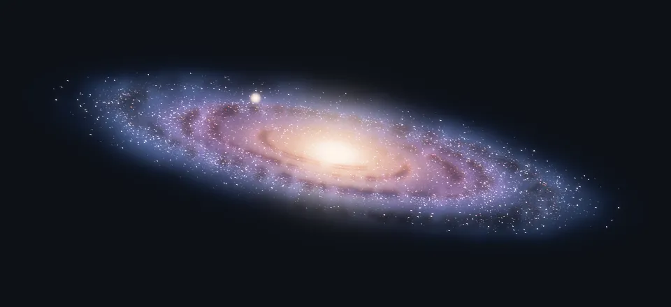
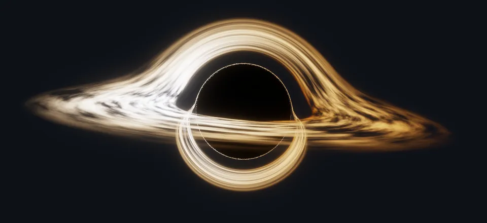

<picture>
  <source media="(prefers-color-scheme: dark)" srcset="assets/galaxy-dark.webp">
  <source media="(prefers-color-scheme: light)" srcset="assets/galaxy-light.webp">
  
</picture>

<picture>
  <source media="(prefers-color-scheme: dark)" srcset="assets/blackhole-dark.webp">
  <source media="(prefers-color-scheme: light)" srcset="assets/blackhole-light.webp">
  
</picture>

<details>
<summary><sub>How these are made</sub></summary>

<sub>

Both loops are rendered on the CPU by the Rust program in [`src/`](src): the black hole by tracing light along curved paths around a Schwarzschild black hole, and the galaxy by marching rays through a volume of stars, gas and dust. Each scene renders once per GitHub theme onto the matching page background, then [`scripts/render.sh`](scripts/render.sh) encodes it as a seamless 5-second animated WebP at 30 fps. To re-render everything:

```sh
nix run .#render
```

</sub>
</details>
